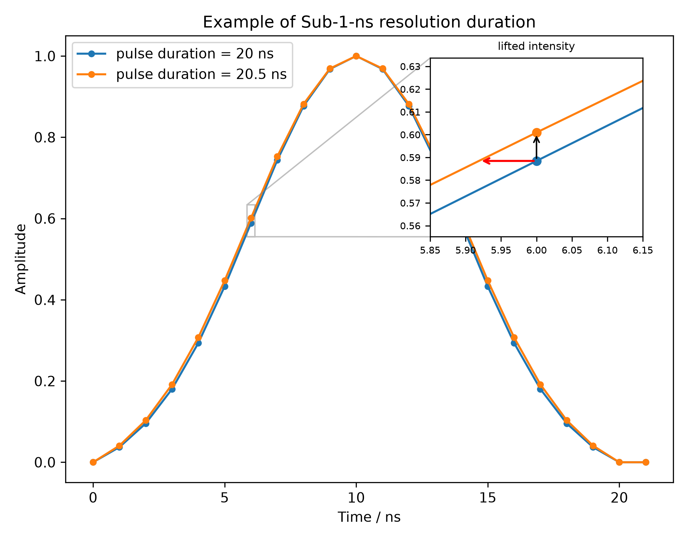
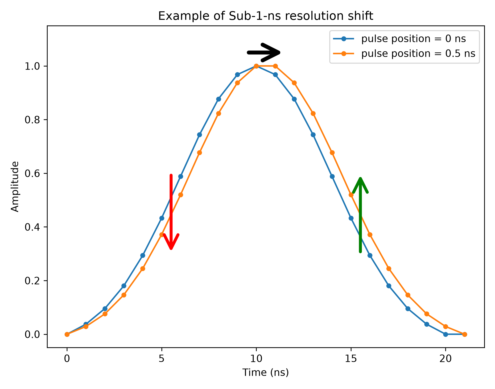
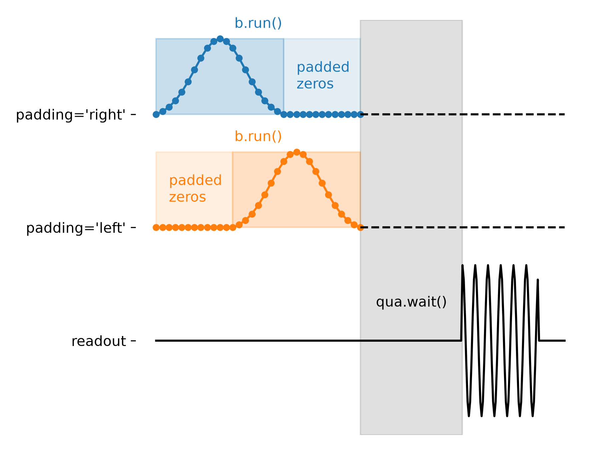

# Baking beyond the clock-cycle resolution

QUA's real-time `wait()` / `play(..., duration=...)` only resolve to 4 ns
clock cycles, and analog pulses on the OPX1000 must be at least 16 ns and a
multiple of 4 ns. **Baking** (`qualang_tools.bakery`) works around both
limits by letting you author a waveform sample-by-sample in Python, outside
those constraints, and have it inserted into the QM config as an ordinary
arbitrary pulse:

```python
with baking(config, sampling_rate=..., padding_method=...) as b:
    b.add_op("my_op", element, [i_samples, q_samples])
    b.wait(n_samples, element)   # optional: silence before/after
    b.play("my_op", element)
b.run()  # or reference b in a QUA program, e.g. via deterministic_run
```

Baking edits `config` directly, so it must run **before** opening a
`QuantumMachine`. The four functionalities the examples below build on:

- **Sub-1-ns resolution duration**, via `sampling_rate`. Passing e.g. `sampling_rate=1e10`
  means each integer sample you author is 100 ps, not 1 ns. On exit, baking
  interpolates your high-rate waveform back onto the OPX's native 1 ns grid
  — a fractional-ns change survives as a smoothly stretched envelope, not a
  whole extra sample. This only works for a shape whose amplitude varies
  smoothly with duration (a Gaussian); a constant-amplitude square pulse
  can't encode sub-ns information this way.

  
- **Sub-1-ns resolution shift**, using a leading `b.wait(...)` authored on that same
  high-rate grid before `b.play(...)`. Baking interpolates the wait and the
  pulse together as one continuous waveform, so the shift also lands as a
  smooth, sub-sample amplitude change — not just moving whole zero samples.

  
- **`padding_method`** controls where baking pads a waveform up to the
  hardware's minimum length / multiple-of-4 requirement: `"right"` (pad
  after, pulse starts immediately), `"left"`, `"symmetric_l"`/`"symmetric_r"`,
  or `"none"` (pad manually yourself; baking raises an error if the length is
  already illegal). Details can be found in [bakery documentation](../../qualang_tools/bakery/README.md).
  
- **The OPX1000 waveform cache** (`type: "array"` `samples_array` +
  `load_waveform(op, index, element)`) lets you store many equal-length
  arbitrary waveforms as *entries* under a single config pulse, swapped in
  right before `play()`, instead of baking a separate config operation per
  point.

  ```mermaid
  flowchart LR
      python["Python: baking(...)"]
      qua["QUA program"]

      subgraph cache["waveform cache (2D array)"]
          direction TB
          row0["row 0 (1D waveform)"]
          row1["row 1 (1D waveform)"]
          rowN["row N (1D waveform)"]
      end

      python -- "baking: append row" --> row1
      row0 -- "load_waveform: pop row" --> qua
  ```

## Examples

Each file is runnable on its own and gated by a `RUN_MODE` constant near the
top:

- `"bake_only"` (default) — bake, print a summary, show the plots. No OPX
  needed.
- `"compile"` — also print the generated QUA script.
- `"simulate"` — run on the QM simulator (edit `HOST_IP`/`CLUSTER_NAME`
  first).
- `"execute"` — run on real hardware (edit `HOST_IP`/`CLUSTER_NAME` first).

To try any example, just run it — no hardware required for the default mode:

```bash
python 1_baking_hybrid_duration_sweep.py
```

### `1_baking_hybrid_duration_sweep.py`

Sweeps a **square** pulse's duration 1 ns → 1 us in 1 ns steps without
baking every length. Bakes only the 15 lengths the hardware can't play
natively (1–15 ns, `padding_method="right"`), and for any longer duration
`T`, splits it into a real-time `play(duration=...)` (the largest multiple
of 4 ns) plus one of those 15 baked pulses for the 0–3 ns remainder. This
concatenation is only exact because a square is constant-amplitude — see
example 2 for why it fails for a Gaussian. **Try it**: run as-is, then try
changing `DURATION_MAX_NS` or `SQUARE_AMP` and re-run to see the printed
duration-split table and plots update.

### `2_baking_fine_time_sweep.py`

Sweeps a single **Gaussian**'s duration in 100 ps steps using the sub-ns
`sampling_rate` grid, padding every point to the same fixed baked length
(`padding_method="none"`). Includes a `check_dac` (`_utils.py`) sanity
check alongside a few representative points: it DAC-rounds the baked
waveform and fits it back to the intended Gaussian, warning if `duration`,
`center`, or `amp` drift beyond tolerance. **Try it**: run as-is to see the
duration sweep plotted at 1 ns and zoomed at 100 ps; try lowering
`GAUSS_AMP` to see the DAC-check start flagging real quantization error at
low amplitude, or set `dac_check = False` to skip it.

### `3_baking_pulse_shift.py`

Sweeps a fixed-length Gaussian's **position** (its start, `shift`) within a
fixed window in 100 ps steps, via a leading `b.wait(shift, element)` baked
together with the pulse — same sub-ns mechanism as example 2, applied to a
delay instead of a duration. Uses the same `check_dac` pattern, this time
checking the fitted pulse `center` tracks the intended shift. **Try it**:
run as-is to see the pulse slide across the window in the plots; try
changing `WINDOW_NS` or `PULSE_LEN_NS` (the DAC-check's `SHIFT_MAX_NS` is
derived automatically to keep the pulse inside the window).

### `4_baking_cached_gaussian_sweep.py`

The scalable version of example 2 (and, in principle, example 3): instead
of baking one config *operation* per sweep point — which stops scaling once
you need thousands of points — every baked Gaussian becomes one *entry* in
an OPX1000 waveform cache (`samples_array`), loaded at runtime with
`load_waveform` right before `play()`. Same sub-ns `sampling_rate` grid and
`check_dac` validation as example 2. **Try it**: run as-is (16–32 ns
sweep), then try setting `DURATION_MAX_NS = 1000` to see it automatically
split across multiple 1024-entry cache arrays.

## Other files

- `_utils.py` — shared helpers: `gaussian_i` (the Gaussian waveform generator
  used to build every example's pulse), `gaussian_model` (the same shape as a
  fittable function of `nu`/`sigma`/`amp`, used by `check_dac`), `index_of`,
  `time_from_center` (plotting helpers), and `check_dac` (the DAC-rounding
  sanity check used by examples 2–4).
